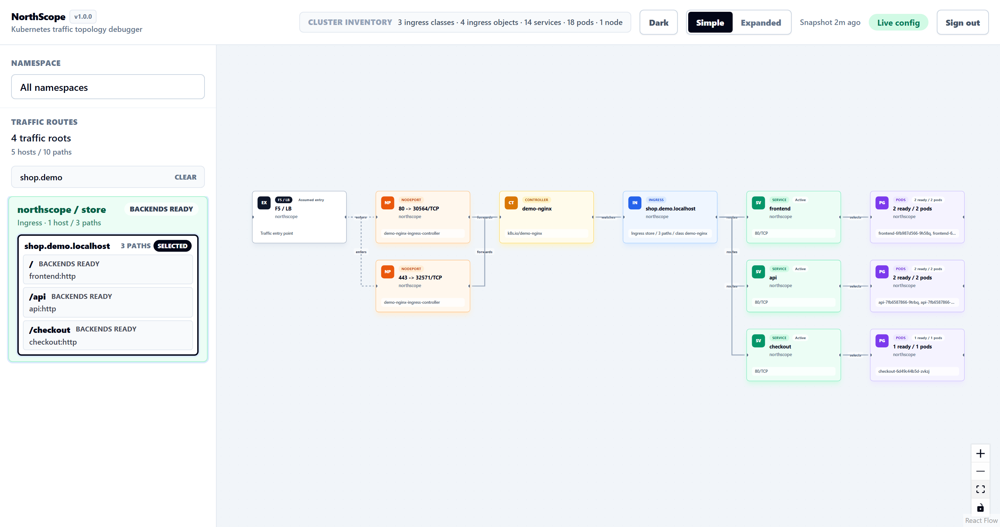

# NorthScope

[](https://github.com/emircanagac/northscope/actions/workflows/ci.yml)
[](LICENSE)

Read-only Kubernetes traffic topology debugger. Pick a host and see its configured path from the load balancer and ingress controller through Ingress or Gateway API routes, Services, and endpoints to Pods.

<picture>
  <source media="(prefers-color-scheme: dark)" srcset="docs/assets/northscope-dark.png">
  
</picture>

## Features

- Search hosts, paths, and Services across namespaces; switch between Simple and Expanded views.
- Ingress, Gateway API, and F5 CIS resources, discovered when their APIs are installed.
- Diagnostics for missing Services, wrong backend ports, unready Pods or endpoints, and stale watches.
- Read-only RBAC, built-in sign-in, and Kubernetes 1.20 or newer.

NorthScope reads Kubernetes configuration only. It does not capture traffic or probe connectivity.

## Install

Requirements: Kubernetes 1.20+, Helm 3, and an ingress controller. The TLS Secret can come from cert-manager or your own certificate.

```bash
helm repo add northscope https://emircanagac.github.io/northscope
helm repo update
helm upgrade --install northscope northscope/northscope \
  --namespace northscope --create-namespace \
  --set ingress.enabled=true \
  --set ingress.className=nginx \
  --set 'ingress.hosts[0].host=northscope.example.com' \
  --set 'ingress.tls[0].secretName=northscope-tls' \
  --set 'ingress.tls[0].hosts[0]=northscope.example.com'
```

Open `https://northscope.example.com` and sign in as `admin` with the generated password:

```bash
kubectl -n northscope get secret northscope-auth -o jsonpath='{.data.password}' | base64 -d; echo
```

To try it without an Ingress, install without the `ingress` flags and run `kubectl -n northscope port-forward svc/northscope 18080:80`.

See the [chart values](charts/northscope/values.yaml) and [production access guide](docs/production-access.md) for your own password, GitOps with `auth.existingSecret`, SSO at the edge, NetworkPolicy, and namespace-scoped installs.

## Demo

Load sample healthy and broken routes into a test cluster after installing NorthScope:

```bash
kubectl apply -f https://raw.githubusercontent.com/emircanagac/northscope/main/examples/demo-topology.yaml
```

## Security

NorthScope only uses `get`, `list`, and `watch`, and never reads Secrets or Pod logs through the Kubernetes API. The UI requires a sign-in by default because topology data includes internal hostnames and IPs. Report vulnerabilities as described in the [security policy](SECURITY.md).

## Status

NorthScope is an early preview. Real-cluster feedback and [bug reports](https://github.com/emircanagac/northscope/issues) are welcome.

## Documentation

- [Production access](docs/production-access.md)
- [Troubleshooting](docs/troubleshooting.md)
- [Changelog](CHANGELOG.md)
- [Contributing](CONTRIBUTING.md)

## License

[Apache 2.0](LICENSE)
