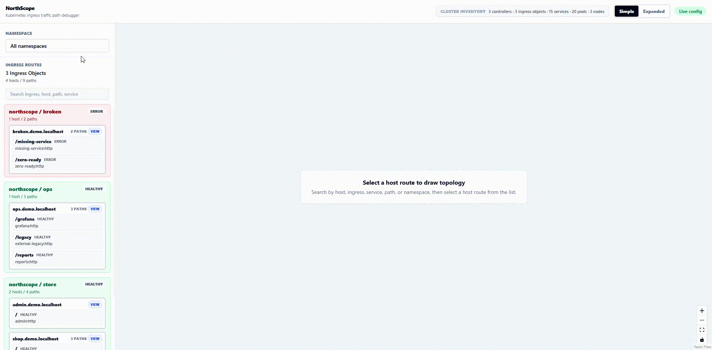

# NorthScope


Read-only Kubernetes traffic topology debugger. Follow a host's configured route from its controller to Services, Pods, and endpoints in one view.



- Search across namespaces by route, host, path, or Service.
- Use **Simple** for a compact traffic path or **Expanded** for individual Pods, endpoints, and Nodes.
- Identify missing Services, invalid backend ports, and backends with no ready endpoints.
- Discover Kubernetes Ingress, Gateway API, and F5 CIS resources when their APIs are available.

NorthScope reads Kubernetes configuration; it does not capture traffic or actively test connectivity. An external F5/LB entry is assumed, not discovered.

## Install

Requires Kubernetes 1.20+ and Helm 3.

```bash
helm repo add northscope https://emircanagac.github.io/northscope
helm repo update
helm upgrade --install northscope northscope/northscope \
  --namespace northscope \
  --create-namespace
```

Follow the access instructions printed by Helm. NorthScope asks you to sign in: the username is `admin`, and the chart generates a random password on first install. Read it with:

```bash
kubectl -n northscope get secret northscope-auth -o jsonpath='{.data.password}' | base64 -d; echo
```

Then search for and select a host route. Switch to Expanded when you need more detail.

To choose the password yourself, set `auth.password`. For `helm template` and GitOps tools such as Argo CD or Flux, create the Secret yourself and set `auth.existingSecret`; see [Production Access](docs/production-access.md#built-in-sign-in).

For Ingress access and other options, see the [chart values](charts/northscope/values.yaml) and [production access guide](docs/production-access.md).

## Try A Demo

To explore healthy and broken routes in a test cluster:

```bash
kubectl apply -f https://raw.githubusercontent.com/emircanagac/northscope/main/examples/demo-topology.yaml
```

Select the `northscope` namespace. To remove the demo, run the same command with `delete` instead of `apply`. On Kubernetes 1.20, the demo's manually managed EndpointSlice is skipped because it uses `discovery.k8s.io/v1`; the rest of the demo still applies.

## Status And Security

NorthScope is an early preview / pre-beta project. Real-cluster feedback and bug reports are welcome.

Kubernetes access is read-only (`get`, `list`, `watch`). NorthScope does not read Secrets or Pod logs through the Kubernetes API; its own login is mounted into the Pod as a file. The UI requires a sign-in by default because topology data includes internal hostnames and IPs. See the [security policy](SECURITY.md).

## Resources

- [Troubleshooting](docs/troubleshooting.md)
- [Contributing](CONTRIBUTING.md)
- [Changelog](CHANGELOG.md)
- [Report an issue](https://github.com/emircanagac/northscope/issues)

Licensed under [Apache 2.0](LICENSE).
